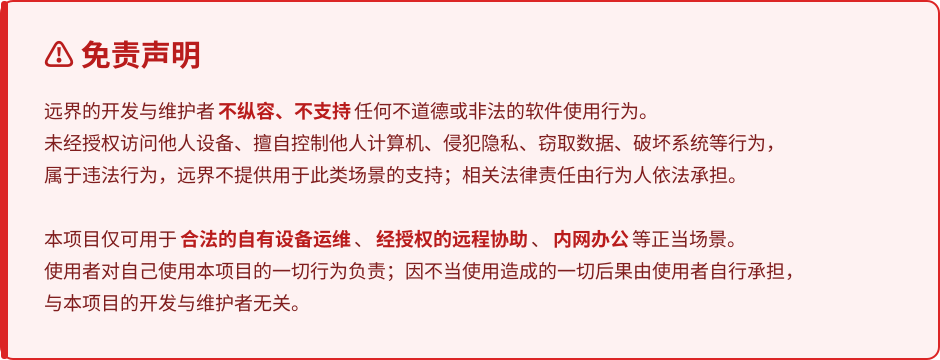

# 远界

**基于 RustDesk 开发的私有化远程控制方案** —— 服务端、客户端、编译环境全套自给自足，数据不出内网。

---



> **免责声明（文字版）**
>
> 远界的开发与维护者**不纵容、不支持**任何不道德或非法的软件使用行为。
>
> 未经授权访问他人设备、擅自控制他人计算机、侵犯他人隐私、窃取他人数据、破坏他人系统等行为，
> 严格违反本项目的使用准则，情节严重的将依法追究法律责任。
>
> 本项目仅可用于**合法的自有设备运维**、**经授权的远程协助**、**内网办公**等正当场景。
> 使用者对自己使用本项目的一切行为负责；因不当使用本项目所造成的一切后果，
> 由使用者自行承担，与本项目的开发与维护者无关。

---

## 这是什么

一套可以完全部署在自己内网的远程控制方案，包含三部分：

| 组成 | 说明 | 装在哪 |
|---|---|---|
| **自建服务器** | 信令服务器、中继服务器、Web 管理面板 | 麒麟 / CentOS / Debian 等 systemd 服务器 |
| **定制客户端** | Windows 版，已内置你的服务器地址 | 直接发给最终用户 |
| **构建机方案** | 需要改客户端时，一键装好内网编译环境 | 内网 Windows 构建机 |

## 相比直接用公共版，好在哪

- **数据不出内网** —— 信令、中继、设备列表、连接记录全在你自己机房里
- **开箱即用** —— 客户端解压双击就连，不需要教用户填服务器地址和 Key
- **自己的品牌** —— logo、应用名、图标、主题色全换成你自己的
- **一条命令部署** —— 服务端、面板、防火墙、开机自启、自检，一条命令搞定
- **不用连外网** —— 编译环境、依赖源码全部离线提供，内网机上装得动、编得出
- **浏览器里管** —— 品牌、设备黑白名单、密钥、构建任务、日志，都在一个面板里

## 快速开始

### 第 1 步 · 装服务器

把部署包里的 `01-server-kylin` 传到服务器，然后：

```bash
cd 01-server-kylin
sudo bash install.sh
```

脚本会装好信令/中继服务器和管理面板、注册开机自启、放行防火墙端口，最后自检
并打印面板地址、账号密码、客户端 Key 和客户端配置串。

常用参数：

| 参数 | 说明 |
|---|---|
| `--server-host <ip>` | 对外地址，不填自动探测本机 IP |
| `--panel-user <name>` | 面板账号，默认 `admin` |
| `--panel-password <pw>` | 面板密码，不填随机生成 |
| `--panel-port <port>` | 面板端口，默认 `21120` |
| `--no-firewall` | 不动防火墙 |
| `--uninstall` | 卸载（配置和密钥保留） |

### 第 2 步 · 发客户端

`03-client-windows/远界-client-windows-x64.zip` 解压就能用，不需要安装、不需要配置。
服务器地址和 Key 已经内置在客户端里。

### 第 3 步 · 换成自己的品牌（可选）

在管理面板「品牌定制」页上传 logo、填应用名、选主题色，然后重新走一遍第 2 步的构建，
新包就带上了。

### 附：搭一台自己的构建机（可选）

只有需要**重新编客户端**时才需要。把 `02-build-agent-windows` 拷到内网 Windows 机器，
改一下 `deploy-config.txt`（填面板地址和 token，token 在服务器的
`/etc/rustdesk-panel/panel.conf` 里），然后：

```bat
setup.cmd
```

双击就行 —— 装好完整离线编译环境、注册成面板的构建节点、顺带挂上开机自启。
之后在面板「客户端构建」页点「开始构建」，这台机器自动领任务、编译、把产物回传面板。

> 构建机需要装 **MSVC 工具集 + Windows SDK**（装 Visual Studio 时选「使用 C++ 的桌面开发」
> 或只装工具集组件都行）。环境细节见下面的「从源码构建」。

## 从源码构建

### 方式一：离线构建机（推荐）

不想折腾环境，就用**内网构建机**方案：在一台能上外网（或能从别处拷包）的 Windows 机器上
把离线环境打好，整包拷进内网，装一次就能一直编。

```bat
setup.cmd
```

它会做三件事：装好完整的编译环境、把机器注册成面板的构建节点、挂上开机自启。
之后在面板「客户端构建」页点「开始构建」，这台机器自动领任务、编译、把产物回传面板。

离线包怎么打、里面有什么，见部署包里的 `README.md`（`02-build-agent-windows/`）。

### 方式二：手工在 Windows 上编

需要这几样：

| 依赖 | 版本 | 说明 |
|---|---|---|
| Rust | 1.99.1 | 官方 MSI 装，按用户装就行，不需要管理员 |
| Flutter | 3.24.5 | 官方 zip 解压 |
| MSVC 工具集 + Windows SDK | —— | 装 Visual Studio 选「使用 C++ 的桌面开发」，或只装工具集组件 |
| CMake | 4.x | 独立版即可（Flutter 找不到 VS 自带的会退回用它） |
| libclang | —— | `kcp-sys`、`scrap` 的 bindgen 要用 |
| NASM | 3.x | 编汇编用 |
| vcpkg 预置库 | `x64-windows-static` | libvpx / libyuv / aom / opus 等，只需编一次 |

**① 准备 C++ 依赖库**（在仓库根目录，manifest 模式，只需一次）

```powershell
vcpkg install --triplet x64-windows-static
```

**② 离线依赖源码**（有网时做一次，之后 cargo 完全不联网）

```powershell
cargo vendor --locked --versioned-dirs .vendor
```

用 `.vendor` 时要在源码树里放一份源替换配置，`.deploy/` 里有现成的生成脚本
（`prepare-offline-bundle.ps1` 会一并写好）。**注意**：RustDesk 有一批 git 依赖
（`[patch.crates-io]` 里的 webrtc / tungstenite 等），源替换配置必须包含那些 git 源段，
只写 crates-io 一段会退回去连 GitHub。

**③ 设置环境变量**

```powershell
$env:VCPKG_ROOT          = 'C:\vcpkg'
$env:VCPKG_INSTALLED_ROOT= 'C:\vcpkg\installed'
$env:LIBCLANG_PATH       = 'C:\libs\llvm\bin'      # libclang.dll 所在目录
$env:FLUTTER_CMAKE_PATH  = 'C:\libs\cmake\bin\cmake.exe'
$env:PATH = "C:\vcpkg;C:\libs\nasm;$env:LIBCLANG_PATH;C:\libs\flutter\bin;$env:USERPROFILE\.cargo\bin;$env:PATH"
```

**④ 编 Rust 侧**

```powershell
cargo build --locked --features flutter --lib --release
```

产物 `target/release/librustdesk.dll`。`--locked` 不能省，依赖版本是锁死的。

**⑤ 编界面**

```powershell
cd flutter
flutter pub get --offline      # 有 pub cache 时用 --offline, 不然会去连 pub.dev
flutter build windows --release
```

产物在 `flutter/build/windows/x64/runner/Release/`（`rustdesk.exe` + `librustdesk.dll`
+ `flutter_windows.dll` + 各插件 dll + `data/`）。

### bridge 代码

`src/bridge_generated.rs`、`src/bridge_generated.io.rs`、`flutter/lib/generated_bridge.dart`
这些是 FFI 桥接代码，**仓库里已经带好了**，clone 下来直接能编。

要重新生成（改了 `src/flutter_ffi.rs` 之后）：

```powershell
flutter_rust_bridge_codegen --version 1.80.1
# 需要 libclang:
flutter_rust_bridge_codegen --rust-input ./src/flutter_ffi.rs `
  --dart-output ./flutter/lib/generated_bridge.dart --llvm-path C:\libs\llvm
```

> 版本必须钉死 1.80.1，换版本生成的代码对不上。

### 打成能发给用户的包

改完品牌或服务器配置后，用面板走一遍「客户端构建」即可（logo、应用名、服务器地址会
自动烘焙进客户端）。手工来就是：

```powershell
.deploy\package\client\package.ps1 -BrandingDir <品牌包目录>
```

它会把 logo / 应用名写进 `flutter/assets/` 和 `res/`，把服务器配置写进
`src/server_preset.txt`，然后编出并打包。

### 在 Linux 服务器上编 Linux 客户端

服务器上装了源码树的话，面板能直接编 Linux 客户端（`cargo build` + `flutter build linux`）。
Windows 客户端**只能**在 Windows 上编，没有交叉编译这条路。

代码注释全部是中文；`src/lang/` 是界面翻译表。

## 目录结构

```
远界/
├── src/                客户端主程序（Rust）
├── libs/               核心库：共享部分 + 客户端专属部分
├── flutter/            界面（Dart）
├── res/                图标、依赖端口定义
├── .deploy/            部署相关：管理面板、构建调度、离线包、服务端部署脚本
├── Cargo.toml          Rust 工程
├── vcpkg.json          C++ 依赖清单
└── LICENCE             许可证
```

## 许可与致谢

本项目**基于 [RustDesk](https://github.com/rustdesk/rustdesk) 开发**，遵循
**AGPL-3.0** 协议（见 [LICENCE](LICENCE)）。

感谢 RustDesk 及其贡献者 —— 远界的客户端主体、界面、通信协议、跨平台能力都来自他们。
本项目在其基础上增加了私有化部署体系、品牌定制流程与内网离线构建方案。

> 本项目与 RustDesk 官方无隶属关系。RustDesk 的商标与版权归其作者所有。
